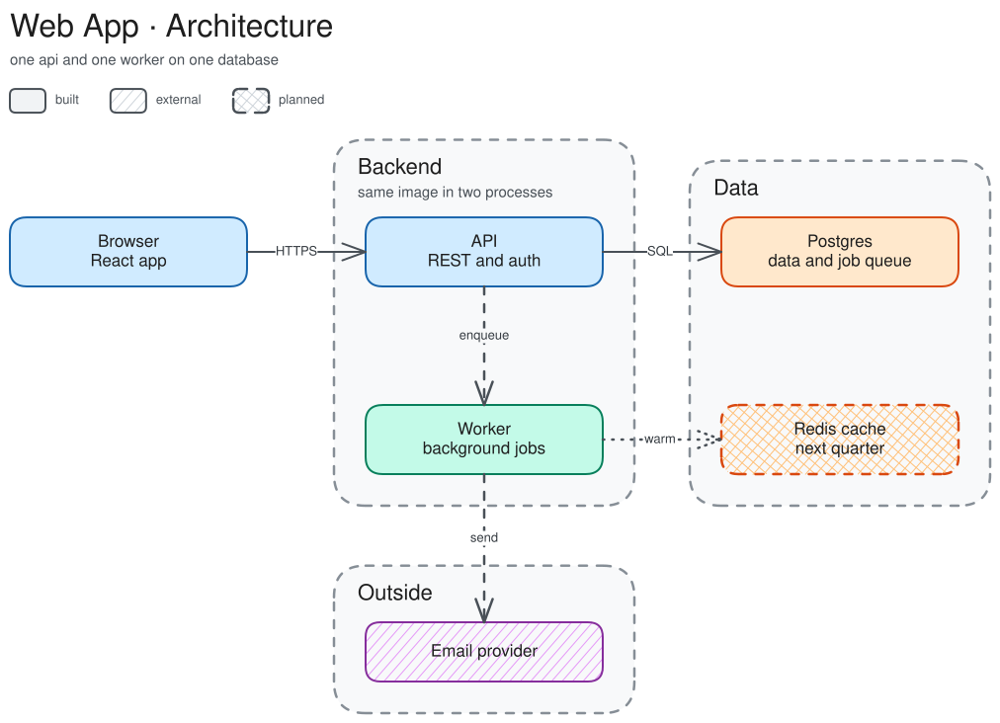

# excalidraw-as-code

A Claude Code skill that draws architecture and flow diagrams as Excalidraw files.
Claude writes a small Python script that lays the diagram out on a grid, the script reports
overlaps and labels that don't fit, then it renders the diagram and Claude reviews a preview
and fixes it before showing you.

Fill patterns carry meaning. Solid means built, hachure means a third party, cross-hatch with
a dashed outline means planned, zigzag means being retired.



## What you get

| File | Use |
|---|---|
| `system.py` | the build script, edit and rerun it to change the diagram |
| `system.excalidraw` | open at excalidraw.com to keep editing by hand |
| `system.svg` | drop into docs, READMEs and wikis |

Ask for a PNG when you need one for slides or chat.

## Install

Copy this folder into a Claude Code skills directory.

| Scope | Location |
|---|---|
| Just you, every project | `~/.claude/skills/excalidraw-as-code/` |
| One project, shared with the team | `<project>/.claude/skills/excalidraw-as-code/` |

Then ask Claude something like "draw the architecture of this repo" or
"/excalidraw-as-code a diagram of the login flow".

## Needs

- Python 3.9 or newer, no packages
- Internet access to kroki.io for rendering, or your own Kroki with
  `docker run -p 8000:8000 yuzutech/kroki` and `KROKI_URL=http://localhost:8000`
- Chrome, Edge or Chromium for the preview and PNG (set `BROWSER_BIN` if it isn't found)

## Use it without Claude

```bash
python examples/web_app.py
python scripts/render.py examples/out/web_app.excalidraw          # svg plus a temp preview
python scripts/render.py examples/out/web_app.excalidraw --png    # also keep a png
```

## Files

- `SKILL.md` holds the instructions Claude follows
- `scripts/excalidraw.py` is the layout library with boxes, zones, grids, wires, fill states and the layout check
- `scripts/render.py` exports SVG through Kroki and the PNG through a headless browser
- `examples/web_app.py` is a template for new diagrams
