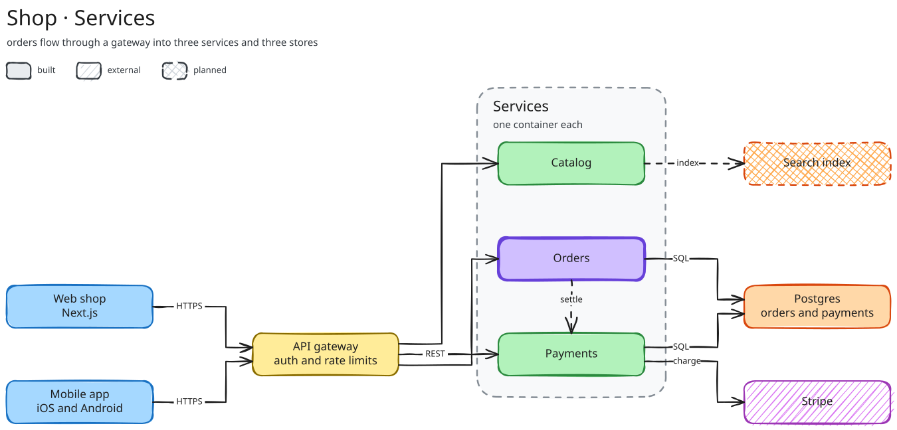

# excalidraw-as-code

An agent skill that draws architecture, flow, sequence and ER diagrams as editable
Excalidraw files.



Ask your agent for a diagram and you get three files:

| File | Use |
|---|---|
| `system.py` | the script that builds the diagram, edit and rerun it to change anything |
| `system.excalidraw` | open at [excalidraw.com](https://excalidraw.com) to keep editing by hand |
| `system.svg` | drop into docs and READMEs |

## Install

Needs Python 3.9+, internet access to [kroki.io](https://kroki.io) for rendering, and Chrome,
Chromium, Edge or Firefox for previews.

**If your agent supports skills**, clone the repo into its skills folder and it picks the skill
up on its own.

```bash
# Claude Code, for you in every project
git clone https://github.com/RividuPesara/excalidraw-as-code ~/.claude/skills/excalidraw-as-code

# or for one project, shared with your team
git clone https://github.com/RividuPesara/excalidraw-as-code .claude/skills/excalidraw-as-code
```

**For any other agent**, clone it anywhere and point the agent at it.

```bash
git clone https://github.com/RividuPesara/excalidraw-as-code ~/tools/excalidraw-as-code
```

Then start your request with something like:

```text
Read ~/tools/excalidraw-as-code/SKILL.md and follow it to draw the architecture of this repo
```

You can also add that line to your agent's rules file, such as `AGENTS.md`, so it uses the
skill every time you ask for a diagram.

To update, run `git pull` in the folder.

## Use

Ask your agent in plain words.

```text
draw the architecture of this repo
make a sequence diagram of the login flow
```

The agent reads your code, writes the script, renders the diagram, checks the preview and fixes
it before showing you.

To run it without an agent, start from an example:

```bash
python examples/microservices.py
python scripts/render.py examples/out/microservices.excalidraw
```

## More

- [Examples](examples/) for flowcharts, sequence diagrams, ER models, icons and UML component and
  deployment views
- [reference.md](reference.md) for the full API, arrowheads, fonts and icon libraries
- [SKILL.md](SKILL.md) for the workflow the agent follows

Diagrams are sent to kroki.io to render. For private diagrams run your own with
`docker run -p 8000:8000 yuzutech/kroki` and set `KROKI_URL=http://localhost:8000`.
